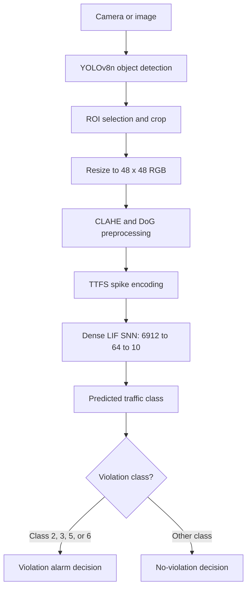

# Hybrid-SNN: Traffic Violation Classification

Hybrid-SNN combines conventional object detection with a Spiking Neural Network (SNN) classifier for traffic-related classification and violation decisions. The target platform described by the project is the Microchip PolarFire SoC FPGA (MPFS250T).

> **Implementation status:** This repository contains software, model artifacts, and FPGA-oriented RTL. The files in this repository alone do not establish successful physical FPGA deployment. Confirm hardware claims using the matching Libero synthesis/implementation reports and board tests.

## Pipeline



The diagram represents the intended software/hardware pipeline. Check the current code and RTL before assuming every stage runs on the FPGA. The current Python inference code runs the SNN through PyTorch on the selected host device; the RTL accelerator is a separate hardware-oriented implementation.

## Model configuration recorded in the source

- Input crop: 48 × 48 RGB
- Input feature count: 6,912
- Hidden LIF layer: 64 neurons
- Output classes: 10
- TTFS time steps: 8
- Leak factor: 0.75
- Target FPGA: Microchip PolarFire SoC MPFS250T
- RTL files: `fpga_rtl/`

## Traffic classes

| ID | Class | Violation mapping |
|---:|---|---|
| 0 | Car | No |
| 1 | Bike compliant | No |
| 2 | Bike no helmet | Yes |
| 3 | Bike overloaded | Yes |
| 4 | Scooter compliant | No |
| 5 | Scooter no helmet | Yes |
| 6 | Scooter overloaded | Yes |
| 7 | Bus | No |
| 8 | Heavy vehicle | No |
| 9 | Auto-rickshaw | No |

## Repository map

- `training/`: SNN model, system configuration, data pipeline, training scripts, and YOLO ROI helper.
- `embedded_runtime/`: host-side runtime and webcam verification entry points.
- `fpga_rtl/`: Verilog LIF accelerator, testbench, cycle-accurate emulator, and exported weight ROM files.
- `vectorblox_deployment/`: deployment configuration/compiler helpers and SNN export artifacts.
- `tests/`: verification and numerical comparison scripts.
- `tools/`: dataset and model diagnostic utilities.
- `docs/`: architecture and implementation status notes.

## Setup

Use Python 3.10 or 3.11 in a clean virtual environment. Install dependencies:

```bash
python -m venv .venv
# Windows: .venv\\Scripts\\activate
# Linux/macOS: source .venv/bin/activate
python -m pip install --upgrade pip
pip install -r requirements.txt
```

The YOLO model weights are not bundled. Install or provide a compatible Ultralytics YOLOv8n checkpoint and update the path expected by `embedded_runtime/runtime_inference.py`. A trained SNN checkpoint is included under `vectorblox_deployment/artifacts/`.

## Run

From the repository root, inspect each script's `--help` options before running. The host webcam entry point is:

```bash
python embedded_runtime/runtime_inference.py --source 0
```

If a command fails because of missing weights, camera permissions, or dependency versions, resolve those prerequisites first. Do not interpret host-side PyTorch execution as FPGA execution.

## Evaluation and reported metrics

The project presentation materials report Top-1 accuracy 52.9%, Top-5 accuracy 94.5%, violation precision 81.7%, recall 83.6%, and F1-score 82.7%. Treat these as **reported figures** until they are reproduced from the included evaluation code, the matching checkpoint, and the exact validation split. The term `functional accuracy` needs its formula documented before it can be interpreted.

Hardware figures have appeared inconsistently in project materials (including different latency values). This README therefore does not claim a verified FPGA latency, power measurement, or completed board deployment. Publish such claims only with the matching Libero reports and board-level evidence.

## Data and privacy

Training crops, personal/debug photos, large raw datasets, Python caches, and temporary output images are intentionally excluded from this repository. Add only datasets that you have permission to redistribute, and document their source and license.

## Limitations and next validation steps

1. Reproduce the reported classification metrics using the exact checkpoint and validation split.
2. Verify consistency between PyTorch model dimensions, exported weights, and RTL dimensions/quantization.
3. Run the Verilog testbench and compare RTL outputs with the software reference.
4. Synthesize and implement the RTL in the appropriate Libero project.
5. Validate clock timing, resource utilization, and power using actual reports.
6. Test the programmed design on the target board before claiming FPGA inference.
