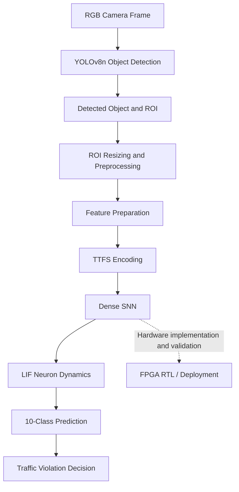

# Hybrid-SNN Traffic Violation Detection

**A hybrid YOLOv8n and Spiking Neural Network approach for traffic-participant classification and violation detection, with FPGA implementation as a hardware exploration target.**

Repository: [Aberlin2006/Hybrid-SNN-Traffic-Violation-Detection](https://github.com/Aberlin2006/Hybrid-SNN-Traffic-Violation-Detection)

---

## 1. Project Overview

Traffic monitoring systems commonly use conventional computer vision models to detect and classify vehicles and identify possible traffic violations. Although these methods can provide effective visual recognition, their computational requirements and frame-based processing approach motivate the exploration of alternative neural computing architectures.

This project investigates a **hybrid vision and Spiking Neural Network (SNN) architecture** for traffic-participant classification and selected traffic violations.

The current approach combines YOLOv8n for object detection with an SNN-based classification stage. Instead of processing the entire camera frame through the SNN, the system first identifies candidate objects, extracts their regions of interest (ROIs), and prepares them for spike-based processing.

The SNN uses Time-to-First-Spike (TTFS) encoding and Leaky Integrate-and-Fire (LIF) neurons to represent and process input features over discrete time steps.

The project also explores FPGA-oriented implementation and optimization. The long-term objective is to investigate a fully SNN-based perception pipeline integrated with an event-driven camera.

**Current scope:** Hybrid YOLOv8n + SNN classification, with FPGA implementation and deployment under development or validation as supported by the available artifacts.

## 2. Objectives

The main objectives of the project are to:

- Develop a hybrid object-detection and SNN-classification pipeline for traffic monitoring.
- Investigate TTFS encoding as a representation for converting image-derived features into spike timing.
- Implement LIF neuron dynamics for temporal processing and classification.
- Identify selected traffic violations using the model's output classes.
- Explore resource-efficient SNN computation and FPGA implementation.
- Establish a foundation for future work involving full-SNN processing and event-driven vision.

## 3. System Architecture

The current conceptual pipeline is shown below.



The diagram describes the intended processing stages. It does not imply that every stage currently executes on the FPGA. The actual execution location of each operation must be confirmed from the implementation and deployment evidence.

### Processing stages

**Stage 1: Image acquisition**

The system receives an RGB image frame from a conventional camera or another supported image source.

**Stage 2: Object detection using YOLOv8n**

YOLOv8n identifies candidate objects in the frame. The detected bounding boxes are used to isolate individual traffic participants for subsequent classification.

**Stage 3: Region-of-interest extraction**

The detected object's region is cropped from the original frame. Processing the ROI reduces the amount of image information passed to the classification stage.

**Stage 4: Image preprocessing**

The ROI is resized to the configured input dimensions and prepared for feature extraction and encoding. The exact preprocessing operations must remain consistent between training and inference.

**Stage 5: TTFS encoding**

The prepared input features are mapped to spike timing. In a TTFS representation, the timing of a neuron's first spike conveys information about its input activation.

**Stage 6: SNN classification**

The encoded features are processed by a dense SNN containing LIF neurons. Neurons accumulate input, account for leakage, and generate spikes when their membrane potential reaches the firing threshold.

**Stage 7: Classification and violation identification**

The output layer produces a prediction among the configured traffic classes. Predictions belonging to the designated violation categories can then be used by the violation-decision stage.

**Stage 8: Hardware exploration**

The SNN computation and associated hardware artifacts are investigated for FPGA implementation. Hardware feasibility, timing, memory usage, power, and end-to-end execution must be validated independently.

## 4. Implementation Details

### 4.1 Object detection

YOLOv8n is used as the object-detection component in the hybrid architecture. Its role is to locate candidate traffic participants before SNN classification.

The separation of detection and classification allows the SNN to operate on a cropped object instead of the complete camera frame.

This design also introduces a dependency on the detector: missed detections, inaccurate bounding boxes, or overlapping objects can affect the classification stage.

### 4.2 Input representation

The configured SNN ROI input is **48 × 48 × 3**, representing a resized RGB image.

The number of scalar channel values is:

\[
48 \times 48 \times 3 = 6,912
\]

These values form the image-derived input representation before any additional feature preparation or encoding.

The exact feature transformation and input mapping should be verified against the corresponding preprocessing and inference code.

### 4.3 Time-to-First-Spike encoding

TTFS encoding represents input information using the timing of the first spike rather than relying only on the number of spikes generated over a time window.

Conceptually, an input feature is mapped to a spike time:

\[
t_i = f(x_i)
\]

where \(x_i\) is an input feature and \(t_i\) is its encoded spike time. The actual mapping function, normalization, time window, and handling of inactive inputs depend on the implementation.

In the current configuration, the SNN uses **8 simulation time steps**.

TTFS is investigated because temporal spike representations can support event-based computation. However, using TTFS alone does not guarantee lower latency or lower energy consumption. These benefits depend on the network, hardware, encoding overhead, and implementation.

### 4.4 Leaky Integrate-and-Fire neurons

The LIF neuron is the basic spiking unit used in the configured SNN.

Its membrane potential integrates incoming synaptic input while gradually losing accumulated potential through leakage. When the potential reaches the threshold, the neuron fires a spike.

A simplified discrete-time model is:

\[
V[t] = \alpha V[t-1](1-S[t-1]) + I[t]
\]

where:

- \(V[t]\) is the membrane potential at time step \(t\).
- \(\alpha\) is the leak factor.
- \(S[t-1]\) is the previous spike output.
- \(I[t]\) is the incoming synaptic current.
- The reset term models the removal of the previous membrane potential after a spike.

The configured leak factor is \(\alpha = 0.75\), and the firing threshold is 1.0.

The exact reset behavior and numerical representation must match the implementation used during training and inference.

### 4.5 Dense SNN architecture

The current model configuration specifies:

| Parameter | Configured value |
|---|---|
| ROI input | 48 × 48 RGB |
| Input channel values | 6,912 before additional feature preparation |
| Encoding | TTFS |
| Simulation steps | 8 |
| Hidden layer | 64 LIF neurons |
| Output layer | 10 classes |
| Leak factor | 0.75 |
| Firing threshold | 1.0 |
| Weight representation | Signed INT8, Q4.4 as specified in the project configuration |

The input dimensions above describe the resized image, not necessarily the final number of features entering the dense layer. Feature transformations, dimensionality reduction, and the precise model input shape must be confirmed from the actual source code.

The configured network is a dense SNN. Convolutional or pooling layers should not be attributed to this architecture unless they are present in the implemented model.

### 4.6 Training and inference

Training establishes the model parameters used to classify the encoded inputs. The trained model is then used during inference to produce output predictions.

Training-time mechanisms, such as surrogate gradients, are distinct from the operations needed for inference. For example, a surrogate-gradient method can support gradient-based optimization of a spiking model even though the forward inference process uses spike-based neuron dynamics.

The repository's training scripts, checkpoints, model definitions, and inference implementation should be used to reproduce the exact workflow.

## 5. Traffic Classification

The model is configured for ten traffic-participant and compliance categories.

| Class ID | Class name |
|---:|---|
| 0 | Car, no violation |
| 1 | Bike, compliant |
| 2 | Bike, no helmet |
| 3 | Bike, overloaded passenger |
| 4 | Scooter, compliant |
| 5 | Scooter, no helmet |
| 6 | Scooter, overloaded passenger |
| 7 | Bus |
| 8 | Heavy vehicle (truck/JCB/bulldozer) |
| 9 | Auto-rickshaw |

The designated violation classes are **2, 3, 5, and 6**.

The detector and classifier serve different purposes. YOLOv8n proposes candidate objects, while the SNN assigns a class to the processed ROI. A detection label should not be treated as proof of a violation without considering the classifier output and the system's decision rules.

## 6. FPGA Implementation

FPGA implementation is an important part of the project's hardware exploration.

The repository separates the main software workflow from hardware-oriented files so that the SNN's computational requirements can be investigated independently.

Relevant hardware considerations include:

- Representation of synaptic weights and neuron state.
- Fixed-point arithmetic and numerical precision.
- Membrane-potential updates and spike generation.
- Memory requirements for model parameters and intermediate values.
- Control and scheduling of operations across time steps.
- Timing closure, resource utilization, and power estimation.
- Integration with the selected PolarFire platform.

### Hardware validation status

The existence of RTL, synthesis artifacts, or deployment-related files does not by itself demonstrate successful end-to-end FPGA inference.

Hardware results should identify whether they come from software profiling, RTL simulation, synthesis reports, timing analysis, or physical board measurements.

Likewise, an SNN running on a host computer is not equivalent to the SNN executing on the FPGA. The execution location of YOLOv8n, preprocessing, encoding, SNN inference, and decision logic must be documented separately.

## 7. Repository Navigation

Use the following links to access the project files directly on GitHub.

| Directory or file | Purpose |
|---|---|
| [README.md](README.md) | Project overview, architecture, setup, and roadmap |
| [docs/](docs/) | Architecture, methodology, and results documentation |
| [training/](training/) | Training-related scripts and configuration, where available |
| [embedded_runtime/](embedded_runtime/) | Inference runtime and related software |
| [fpga_rtl/](fpga_rtl/) | FPGA hardware description and RTL artifacts |
| [vectorblox_deployment/](vectorblox_deployment/) | VectorBlox-related deployment artifacts |
| [tests/](tests/) | Testing and verification code |
| [tools/](tools/) | Utility and helper scripts |
| [requirements.txt](requirements.txt) | Python dependency list |
| [.gitignore](.gitignore) | Files excluded from Git tracking |

Some directories may be under development or may not yet contain a complete workflow. Their contents should be inspected before assuming a particular component is ready to run.

### Repository structure

```text
Hybrid-SNN-Traffic-Violation-Detection/
├── README.md
├── requirements.txt
├── .gitignore
├── docs/
│   ├── architecture.md
│   ├── methodology.md
│   └── results.md
├── training/
├── embedded_runtime/
├── fpga_rtl/
├── vectorblox_deployment/
├── tests/
└── tools/
```

## 8. Getting Started

### Prerequisites

- Python version compatible with the project's dependencies.
- Git.
- A compatible environment for the required machine-learning libraries.
- Trained model weights and dataset files, if they are not included in the repository.

### Step 1: Clone the repository

```bash
git clone https://github.com/Aberlin2006/Hybrid-SNN-Traffic-Violation-Detection.git
cd Hybrid-SNN-Traffic-Violation-Detection
```

### Step 2: Create a virtual environment

```bash
python -m venv .venv
```

Activate it on Windows PowerShell:

```powershell
.\.venv\Scripts\Activate.ps1
```

### Step 3: Install dependencies

```bash
python -m pip install --upgrade pip
pip install -r requirements.txt
```

### Step 4: Inspect the available implementation

Review the files in `training/`, `embedded_runtime/`, and `fpga_rtl/` to identify the actual entry points, model paths, input formats, and supported execution commands.

The commands required to train or run the model depend on the scripts and artifacts included in the repository. No single inference command is specified here because it must match the actual implementation.

### Step 5: Reproduce and validate

Before reporting results, verify the model checkpoint, dataset split, preprocessing configuration, and evaluation script. Record any missing dependencies or external artifacts required to reproduce the experiment.

## 9. Evaluation and Results

Evaluation should cover both classification quality and implementation performance.

### Software evaluation

Useful classification measurements include:

- Overall accuracy.
- Per-class precision and recall.
- Macro-averaged F1-score.
- Confusion matrix.
- ROC-AUC, where appropriate for the evaluation setup.
- Separate precision, recall, and F1-score for violation detection.

The dataset, split, metric definitions, and class mapping must accompany reported numbers. Overall accuracy alone can hide poor performance on individual classes, particularly when class distributions are uneven.

### Hardware evaluation

Relevant hardware measurements include:

- Logic and memory resource utilization.
- DSP usage.
- Clock frequency and timing constraints.
- Inference latency and the operations included in that measurement.
- Power consumption and the method used to obtain the estimate or measurement.

Software latency, simulated RTL latency, synthesis estimates, and measured board-level latency are different quantities and should not be presented as interchangeable.

**Reproducibility:** Add verified results and their supporting evidence to [docs/results.md](docs/results.md). Do not report an unverified result as a completed hardware measurement.

## 10. Limitations

The current approach has several limitations.

**Dependence on conventional object detection**

The pipeline relies on YOLOv8n to identify candidate objects. Missed detections, poor localization, occlusion, and overlapping objects can affect downstream classification.

**Hybrid rather than fully SNN-based processing**

The current approach combines conventional object detection with an SNN classification stage. It is therefore not an end-to-end SNN system, and it does not yet eliminate the conventional frame-based detection stage.

**Input preprocessing requirements**

ROI resizing and feature preparation can affect the information available to the SNN. Differences between training-time and inference-time preprocessing may reduce classification performance.

**Class imbalance and class-specific errors**

The model's performance may vary across vehicle types and violation categories. Overall accuracy alone is insufficient to assess whether every class is reliably recognized.

**Encoding and simulation overhead**

TTFS encoding and multi-step SNN simulation introduce temporal processing requirements. Whether these operations provide practical efficiency benefits depends on the actual hardware implementation and the cost of preprocessing.

**Hardware deployment constraints**

FPGA execution introduces constraints involving memory, arithmetic precision, scheduling, timing, and integration. The complete pipeline must be validated on the target hardware before claims about end-to-end performance can be made.

**Dataset and environmental limitations**

Changes in lighting, camera angle, image quality, traffic density, and real-world appearance may affect performance. Laboratory or dataset results do not automatically establish real-world reliability.

## 11. Future Scope

The long-term direction is to move from the current hybrid pipeline toward a more fully neuromorphic approach.

### 11.1 Fully SNN-based perception

Investigate replacing conventional neural inference stages with SNN-based processing wherever technically feasible. The goal is to reduce dependence on frame-based neural computation and explore a more unified spike-based pipeline.

### 11.2 Event-driven camera integration

Integrate an event-driven camera that reports changes in brightness asynchronously rather than producing only conventional image frames.

This would introduce new requirements for event representation, temporal processing, and the interface between the sensor and the SNN.

### 11.3 End-to-end event processing

Explore a pipeline that converts camera events into suitable spike representations and processes them through an SNN, reducing the need for conventional image reconstruction and frame-based processing.

### 11.4 FPGA optimization

Investigate efficient fixed-point arithmetic, neuron-state storage, weight-memory organization, scheduling, and resource sharing for the target FPGA.

### 11.5 Comparative evaluation

Compare the current hybrid architecture and the future full-SNN architecture under consistent evaluation conditions. Measurements should include classification performance, latency, power, resource usage, and the cost of input preprocessing.

### 11.6 Real-world validation

Evaluate robustness under different traffic conditions, camera viewpoints, lighting, and object densities before considering practical deployment.

These items are planned research directions, not claims that the corresponding features are already implemented.

## 12. License and Third-Party Components

**License status: To be confirmed.**

A repository license should be selected and added only after reviewing the project's ownership, distribution requirements, and the licenses of incorporated code, models, and datasets.

Until a license is added, do not assume that the repository is freely reusable, modifiable, or redistributable.

Third-party components, including the object detector, machine-learning libraries, pretrained weights, and datasets, may have separate licensing and usage requirements. Users should review the applicable terms before redistributing or using them commercially.

## 13. Contributions and Reproducibility

Contributions that improve implementation clarity, testing, documentation, and reproducibility are welcome.

When making changes:

1. Explain the purpose of the change.
2. Keep training and inference preprocessing consistent.
3. Include relevant tests or validation steps.
4. Record the configuration and artifacts used for evaluation.
5. Distinguish measured results from estimates and planned functionality.
6. Document any hardware-specific assumptions.

## 14. Acknowledgements

This project brings together object detection, spiking neural computation, and FPGA-oriented engineering to explore alternative approaches to traffic monitoring.

The work is intended as an evolving engineering prototype, with future development focused on full-SNN processing and event-driven visual perception.
